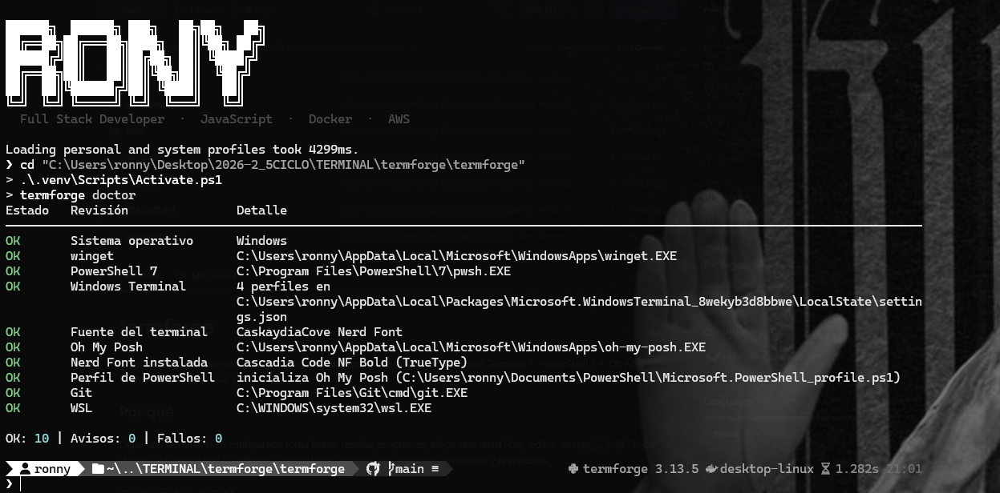

<div align="center">

# ⚒️ termforge

**Diagnostica, respalda y configura tu terminal de Windows**
*(Windows Terminal + PowerShell 7 + Oh My Posh), sin romper lo que ya tienes.*

[](https://github.com/Rony10-az/Termforge/actions/workflows/ci.yml)
[](LICENSE)
[](pyproject.toml)
[](#)



</div>

## Por qué

Dejar una terminal bien configurada toma horas: instalar programas, elegir una Nerd Font,
editar `settings.json`, tocar el perfil de PowerShell. `termforge` convierte ese proceso en
comandos repetibles y **reversibles**.

## Comandos (v0.1)

| Comando | Qué hace |
|---|---|
| `termforge doctor` | Revisa qué falta o está mal (PowerShell 7, Windows Terminal, Oh My Posh, Nerd Font, Git, WSL, perfil) y muestra cómo arreglarlo. `--json` para scripts. |
| `termforge init [--dry-run] [-y]` | Instala con `winget` lo que falte (PowerShell 7, Oh My Posh) y agrega la inicialización de Oh My Posh al perfil de PowerShell. Respalda el perfil antes de modificarlo. |
| `termforge backup [-l etiqueta]` | Guarda una copia de `settings.json` y del perfil de PowerShell. |
| `termforge backups` | Lista los respaldos. |
| `termforge restore [id] [--dry-run] [-y]` | Restaura un respaldo (el más reciente por defecto). Antes guarda el estado actual como `pre-restore`. |

`doctor` termina con código `1` si hay fallos, así que sirve también en scripts y CI.

## Seguridad

- **Backup antes de modificar**: `restore` nunca sobrescribe sin guardar antes el estado actual.
- **`--dry-run`**: muestra qué haría sin tocar nada.
- Lee el `settings.json` de Windows Terminal aunque tenga comentarios y comas finales (JSONC).
- Los respaldos viven en `%LOCALAPPDATA%\termforge\backups` (se cambia con `TERMFORGE_HOME`).

## Instalación

Requiere Python 3.10 o superior.

```powershell
git clone https://github.com/Rony10-az/Termforge.git
cd Termforge
python -m venv .venv
.venv\Scripts\Activate.ps1
pip install -e ".[dev]"

termforge doctor
```

## Desarrollo

```powershell
pytest -q        # tests
ruff check .     # lint
```

Estructura:

```
src/termforge/
├── cli.py       # comandos (Typer + Rich)
├── doctor.py    # diagnóstico
├── init.py      # instalación (winget) y configuración de Oh My Posh
├── backup.py    # respaldo y restauración
├── env.py       # rutas y entorno (simulable en tests)
└── jsonc.py     # lector de JSON con comentarios
tests/           # corren en Windows y Linux (GitHub Actions)
```

Todo lo que depende del sistema pasa por `Env`, por eso los tests simulan una PC con Windows
sin tocar tu configuración real.

## Roadmap

- [x] `doctor`, `backup`, `restore`
- [x] `init`: instalar dependencias con winget y configurar Oh My Posh
- [ ] `theme list / apply`: temas (incluido uno monocromático con color solo para errores y Git)
- [ ] `profiles add`: agregar Git Bash y WSL al menú de Windows Terminal
- [ ] Configuración declarativa (`config.yaml`)
- [ ] Publicar en PyPI y empaquetar `.exe`

## Licencia

Distribuido bajo la licencia MIT. Ver [LICENSE](LICENSE) para el texto completo.
